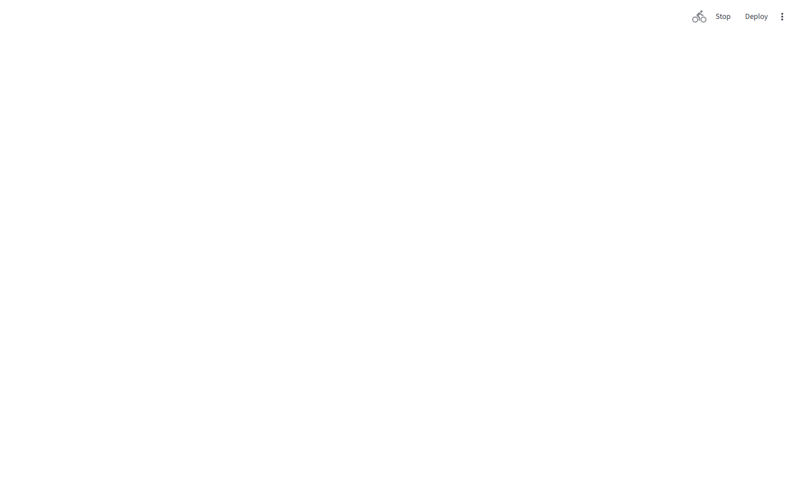

# 🧑 Project 1: Live Face Capture & Recognition

A Streamlit-based biometric face verification module that captures live webcam frames, runs quality checks with red/green indicators, and matches detected faces against registered test identities using InsightFace embeddings and cosine similarity.

---

## 📋 Requirement Coverage

This project is part of a larger **Biometric Identity Verification & Secure E-Signature Platform** and covers the following SRS requirements:

| Requirement | Description | Status |
|---|---|---|
| **FR-02** | Test Identity Registration (CLI-based enrollment) | ✅ Implemented |
| **FR-03** | Live Face Capture with Red/Green Quality Indicators | ✅ Implemented |
| **FR-04** | Face Recognition against Registered Identities | ✅ Implemented |
| **FR-05** | Liveness Detection (Optional) | ⚠️ Not implemented in this version |

**Result outcomes supported:** `Match` / `No Match` / `Unable to Verify`

---

## 🎯 Features

- **Live webcam capture** via Streamlit's `camera_input()`
- **Real-time face detection** using InsightFace `buffalo_l` model (RetinaFace + ArcFace)
- **Quality checks with red/green indicators:**
  - Brightness (mean gray value)
  - Sharpness (Laplacian variance)
  - Face size (bbox-to-frame ratio)
- **Face recognition** using 512-dimensional embeddings
- **Cosine similarity matching** via `sklearn.metrics.pairwise.cosine_similarity` (industry standard, batch-optimized)
- **Configurable match threshold** via sidebar slider
- **Reference image storage** for enrolled identities
- **Text labels alongside colors** (accessibility — not color-dependent)

---

## 🏗️ Architecture

## 📸 Screenshots

### 01 Live Capture

