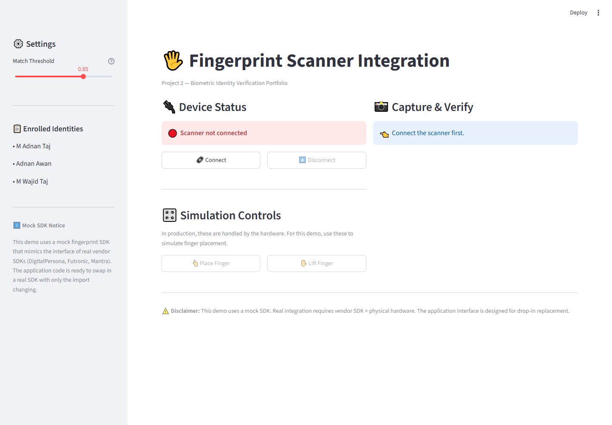
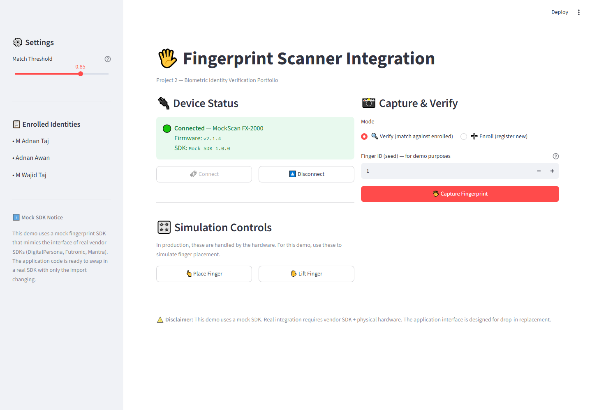
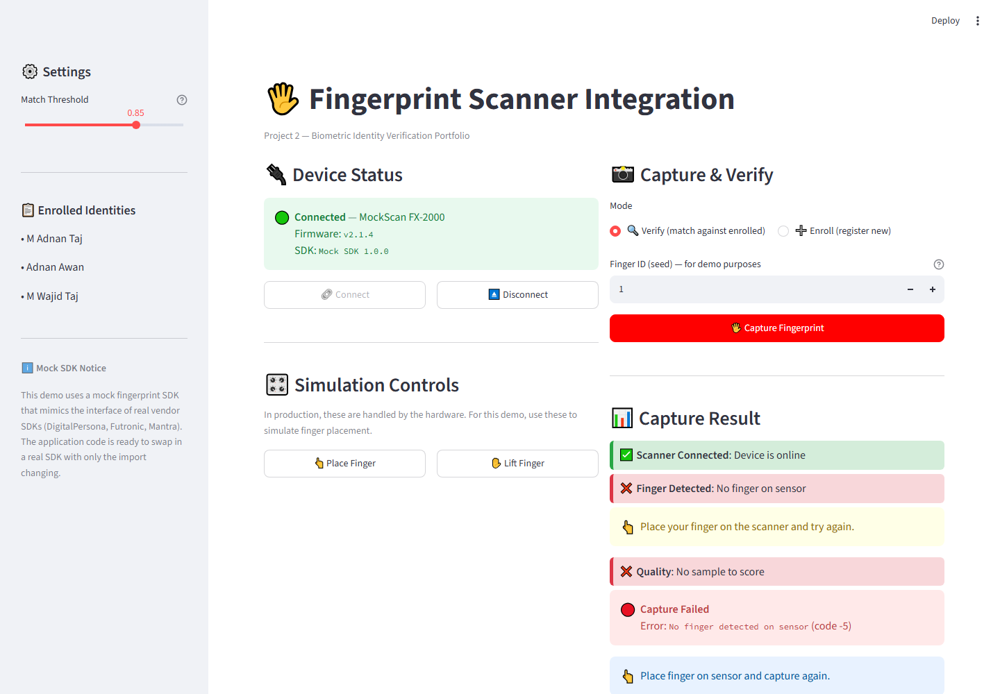
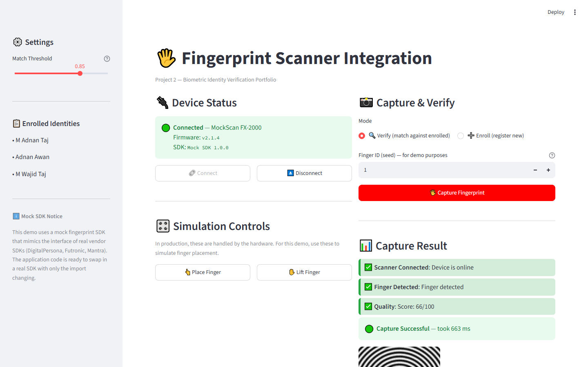

## 📸 Screenshots

### 02 Initial



### 02 Connected



### 02 Finger No Place



### 02 Capture Success




# 🖐️ Project 2: Fingerprint Scanner SDK Integration

A Streamlit-based fingerprint capture and verification module demonstrating vendor SDK integration, quality indicators, and template matching.

---

## 📋 Requirement Coverage

| Requirement | Description | Status |
|---|---|---|
| **FR-06** | Fingerprint capture via compatible scanner + SDK | ✅ Implemented |
| **FR-07** | Fingerprint verification against enrolled templates | ✅ Implemented |

---

## 🎯 Features

- **Device lifecycle management** — connect, disconnect, status query
- **Capture workflow** with:
  - Scanner connection status
  - Finger detection indicator
  - Quality score (0-100)
  - Retry and error messages
- **Template-based verification** against enrolled fingerprints
- **Red/green indicators** with text labels (accessibility)
- **Configurable match threshold**
- **Enrollment mode** — register new fingerprints

---

## ⚠️ Mock SDK Notice

This project uses a **mock SDK** that mirrors the interface of real fingerprint scanner SDKs (DigitalPersona, Futronic, Mantra). The public API shape is:

```python
scanner = FingerprintScanner()
scanner.connect()
result = scanner.capture(timeout=5)
# result.template, result.quality_score, result.error_code, ...

