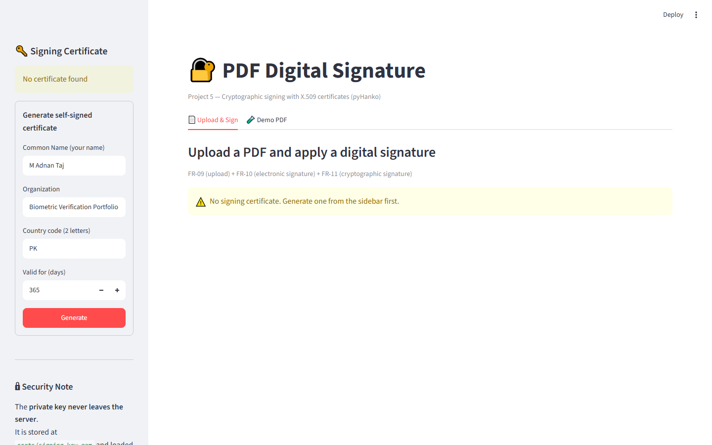
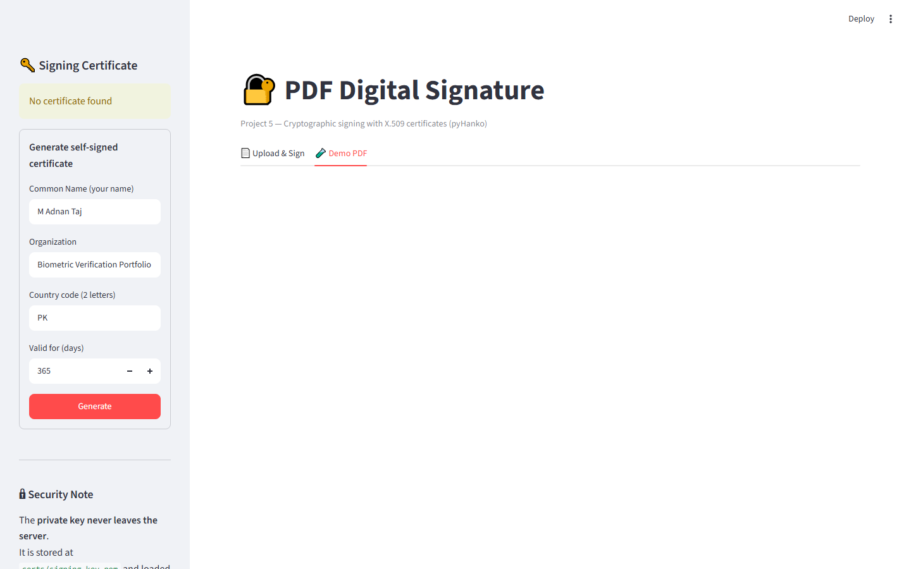

# 🔐 Project 5: PDF Digital Signature

A Streamlit module for applying **cryptographic digital signatures** to PDF documents using X.509 certificates — powered by **pyHanko** and **cryptography**.

**SRS Coverage:** FR-09, FR-10, FR-11

---

## 📋 Requirement Coverage

| Requirement | Description | Status |
|---|---|---|
| **FR-09** | PDF Upload with file type/size/validity checks | ✅ |
| **FR-10** | Electronic Signature (drawn signature image) | ✅ |
| **FR-11** | Cryptographic Digital Signature with X.509 certificate | ✅ |

---

## 🔒 Security Design (Critical)

**The private signing key never leaves the server.**

- Private key stored at `certs/signing_key.pem` (server-side file only)
- Loaded into memory only during signing, inside the backend process
- Never sent to the browser
- Never stored in session_state, cookies, or local storage

This is a **hard requirement in the SRS (FR-11)**: *"Private signing key frontend browser mein expose nahi ki jayegi."*

---

## 🎯 Features

- **Self-signed X.509 certificate generation** (RSA-2048, SHA-256)
- **PDF validation** — size limit, magic-byte check, parse check
- **Drawn signature image upload** (PNG/JPEG) — validated with preview
- **Cryptographic signing** via pyHanko — signature embedded in PDF
- **Signature metadata** — signer name, reason, location
- **Preview and download** the signed PDF
- **Demo PDF generator** for testing without uploading

---

## ⚙️ Setup

```bash
cd 05_pdf_signing
..\01_face_capture_recognition\venv\Scripts\Activate.ps1
pip install pyhanko==0.25.3 cryptography==43.0.3 reportlab==4.1.0

## 📸 Screenshots

### 05 Upload Sign



### 05 Demo Pdf



