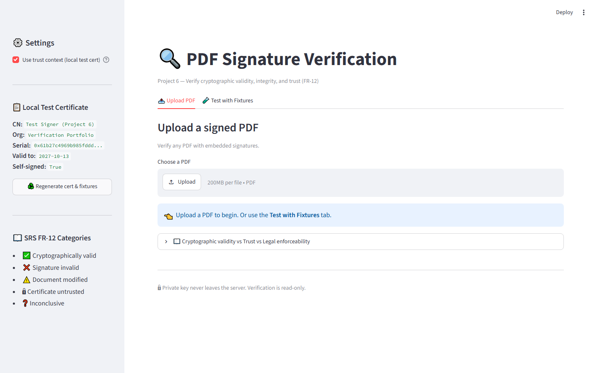
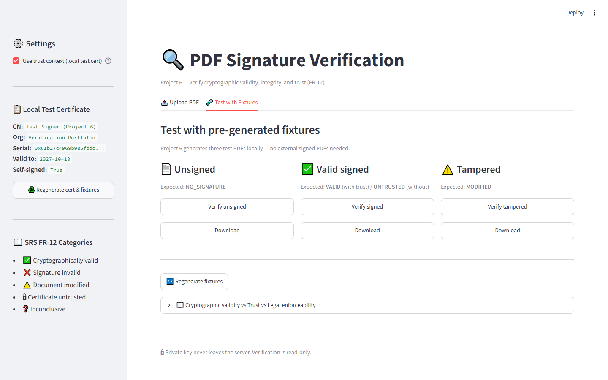
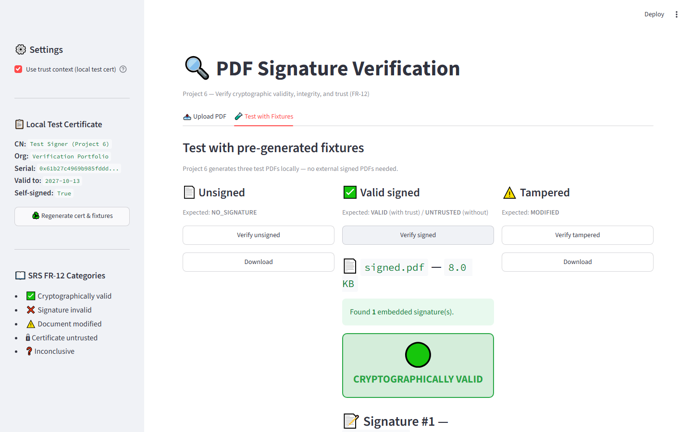

# 🔍 Project 6: PDF Signature Verification Results

## Landing_gage


## Test_with_pre_generated_fixtures_signed


## Test_with_pre_generated_fixtures_unsigned


## Test_with_pre_generated_fixtures_tampered


## Upload_pdf_to_verify_signature


## Upload_signed-pdf


## Upload_unsigned-pdf


## Upload_tampered-pdf


# 🔍 Project 6: PDF Signature Verification

A fully self-contained Streamlit module for verifying cryptographic signatures in PDF documents — using pyHanko.

**SRS Coverage:** FR-12

---

## 📋 Requirement Coverage

| FR-12 Category | Detected by | Demo fixture |
|---|---|---|
| Signature cryptographically valid | `intact=True, valid=True, trusted=True` | `signed.pdf` + trust |
| Signature invalid | `valid=False` | — |
| Document modified after signing | `intact=False` | `tampered.pdf` |
| Certificate expired or untrusted | `trusted=False` | `signed.pdf` (no trust) |
| Verification inconclusive | Parse error | Malformed input |

---

## 🎯 What This Project Demonstrates

Unlike Project 5 (which signs PDFs), Project 6 **only verifies**.

- Generates its own test certificate (`certs.py`)
- Generates 3 test PDFs (`test_fixtures.py`): unsigned / signed / tampered
- Verifies any uploaded PDF with embedded signatures
- Reports per-signature: **intact**, **valid**, **trusted**
- Maps results to the 5 FR-12 categories

**100% independent** — no imports from Project 5.


## ⚙️ Setup

```bash
cd 06_signature_verification
..\01_face_capture_recognition\venv\Scripts\Activate.ps1
pip install -r requirements.txt

## ⚠️ Known Limitations

- **No timestamp authority (TSA) verification.** Signatures carry local time only.
- **No revocation checking (CRL/OCSP).** `allow_fetching=False` blocks network access.
- **Trust root is user-provided.** Production uses the OS trust store.
- **No long-term validation (LTV).** For long-term validity, use PAdES-LTV.
- **Only checks embedded signatures.** Detached signatures are out of scope.

## 📸 Screenshots

### 06 Upload



### 06 Fixtures



### 06 Signed Valid



