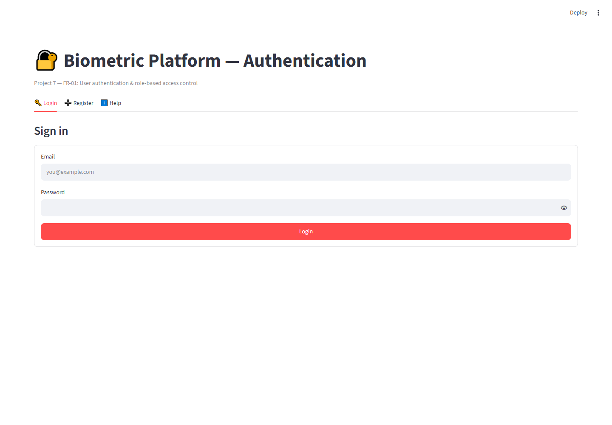
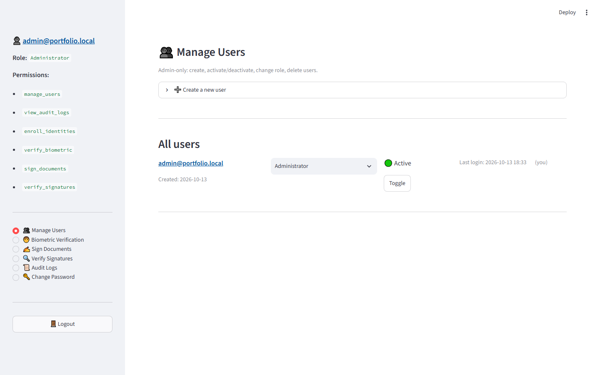
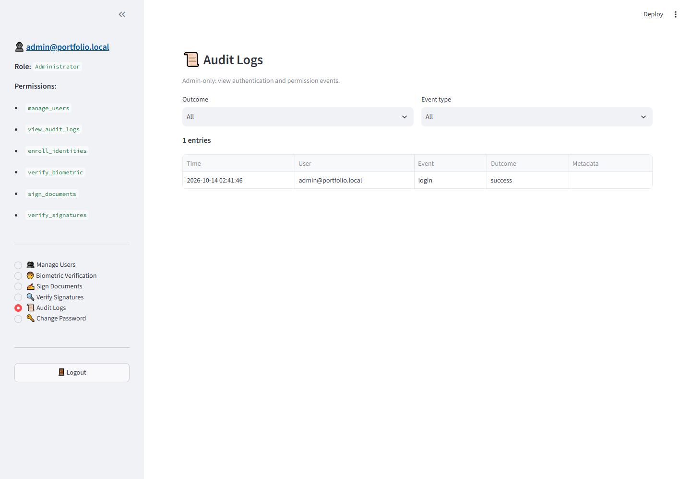

## 📸 Screenshots

### 07 Login



### 07 Dashboard



### 07 Audit Logs



# 🔐 Project 7: Authentication & Role-Based Access Control

A Streamlit module demonstrating secure user authentication with bcrypt, a 4-role permission matrix, admin user management, and authentication audit logging.

**SRS Coverage:** FR-01, partial FR-13, partial FR-14

---

## 📋 Requirement Coverage

| Requirement | Description | Status |
|---|---|---|
| **FR-01** | User authentication (login/logout) + RBAC | ✅ |
| **FR-13** | Audit logs (auth events only — full audit in Project 8) | ✅ Partial |
| **FR-14** | Admin dashboard (user management) | ✅ Partial |

---

## 🎯 Roles (From SRS Section 3)

| Role | Purpose | Key Permissions |
|---|---|---|
| **Administrator** | Manage platform | manage_users, view_audit_logs, enroll_identities, verify_biometric, sign_documents, verify_signatures |
| **Verification Operator** | Run verifications | verify_biometric |
| **Document Signer** | Sign PDFs | sign_documents |
| **Document Verifier** | Verify PDFs | verify_signatures |

Permissions are enforced **server-side** on every action — the UI just hides what a role can't do.

---

## 🔒 Security Features

- **bcrypt password hashing** (cost factor 12) — industry standard
- **Password policy**: min 8 chars, at least 1 letter and 1 number
- **Email validation** on registration
- **Role-based permissions** enforced in backend, not just UI
- **Audit log** for login success/failure, role changes, account status changes
- **No plaintext passwords** ever stored
- **No secrets in the frontend** — everything server-side

---

## 🗄️ Database Schema

### `users`
| Column | Type | Notes |
|---|---|---|
| id | Integer PK | |
| email | String UNIQUE | Indexed |
| password_hash | String | bcrypt |
| role | String | One of the 4 roles |
| is_active | Boolean | Soft disable |
| created_at | DateTime | |
| last_login | DateTime | Updated on each login |

### `audit_logs`
| Column | Type | Notes |
|---|---|---|
| id | Integer PK | |
| user_email | String | Nullable |
| event_type | String | login, logout, role_change, etc. |
| outcome | String | success / failure |
| metadata_json | Text | Safe metadata only |
| timestamp | DateTime | |

---

## ⚙️ Setup

```bash
cd 07_auth_rbac
..\01_face_capture_recognition\venv\Scripts\Activate.ps1
pip install -r requirements.txt


